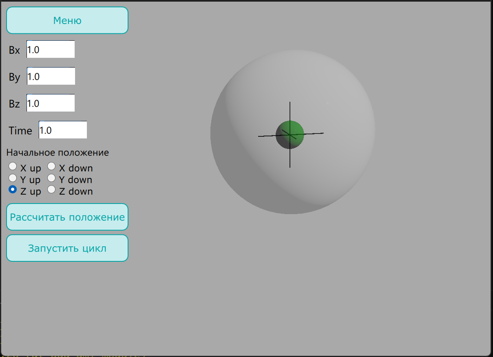

<h1 align="center">Спин в магнитном поле</h1>

  Численная модель динамики спина 1/2 в постоянном магнитном поле.
  Программа позволяет задавать компоненты поля, начальное состояние
  и время эволюции, а затем наблюдать изменение состояния спина.

  

  <em>Главное меню программы: выбор модели с одним спином или с двумя запутанными спинами.</em>

<table>
  <tr>
    <td width="50%" align="center">
      
       
      <strong>Модель одного спина</strong>
      
Задаются компоненты магнитного поля Bx, By и Bz, время эволюции и начальное состояние вдоль одной из осей X, Y или Z. После расчёта отображается вектор Блоха.

    </td>
    <td width="50%" align="center">
      
       
      <strong>Модель двух спинов</strong>
      
Модель демонстрирует два запутанных спина. До измерения нельзя приписать каждому спину отдельное определённое направление; после измерения отображаются результаты измерения.

    </td>
  </tr>
</table>

---

## Математическое описание

Рассмотрим частицу со спином \(1/2\), помещённую в магнитное поле

\[
\vec B=(B_x,B_y,B_z).
\]

Гамильтониан системы:

\[
\boxed{
\hat H=-\frac{\hbar\omega}{2}
\begin{pmatrix}
B_z & B_x-iB_y\\
B_x+iB_y & -B_z
\end{pmatrix}
}
\]

Для краткости введём матрицу

\[
A=
\begin{pmatrix}
B_z & B_x-iB_y\\
B_x+iB_y & -B_z
\end{pmatrix},
\qquad
B=\sqrt{B_x^2+B_y^2+B_z^2}.
\]

### 1. Собственные значения

Решим характеристическое уравнение:

\[
\det(A-\lambda I)=
\begin{vmatrix}
B_z-\lambda & B_x-iB_y\\
B_x+iB_y & -B_z-\lambda
\end{vmatrix}=0.
\]

После раскрытия определителя:

\[
\lambda^2-B_x^2-B_y^2-B_z^2=0.
\]

Следовательно,

\[
\boxed{\lambda_1=B,\qquad \lambda_2=-B.}
\]

Собственные энергии гамильтониана:

\[
\boxed{
E_1=-\frac{\hbar\omega B}{2},
\qquad
E_2=+\frac{\hbar\omega B}{2}.
}
\]

### 2. Собственные векторы

Пусть собственный вектор имеет вид

\[
\psi=
\begin{pmatrix}
a\\b
\end{pmatrix}.
\]

Из уравнения \(A\psi=\lambda\psi\) получаем систему:

\[
\begin{cases}
(B_z-\lambda)a+(B_x-iB_y)b=0,\\
(B_x+iB_y)a-(B_z+\lambda)b=0.
\end{cases}
\]

Для \(\lambda_1=B\) можно выбрать \(a=B+B_z\). Тогда \(b=B_x+iB_y\), поэтому

\[
\psi_1=
\begin{pmatrix}
B+B_z\\
B_x+iB_y
\end{pmatrix}.
\]

Для \(\lambda_2=-B\) можно выбрать \(a=B_z-B\). Тогда \(b=B_x+iB_y\), поэтому

\[
\psi_2=
\begin{pmatrix}
B_z-B\\
B_x+iB_y
\end{pmatrix}.
\]

Нормировочные множители:

\[
N_1=\sqrt{(B+B_z)^2+B_x^2+B_y^2},
\]

\[
N_2=\sqrt{(B_z-B)^2+B_x^2+B_y^2}.
\]

Нормированные собственные векторы:

\[
\boxed{
\psi_1=\frac{1}{N_1}
\begin{pmatrix}
B+B_z\\
B_x+iB_y
\end{pmatrix},
\qquad
\psi_2=\frac{1}{N_2}
\begin{pmatrix}
B_z-B\\
B_x+iB_y
\end{pmatrix}.
}
\]

### 3. Начальное состояние

Начальную волновую функцию разложим по собственным векторам:

\[
\psi(0)=\alpha_1\psi_1+\alpha_2\psi_2.
\]

Коэффициенты разложения находятся скалярными произведениями:

\[
\boxed{
\alpha_1=\psi_1^\dagger\psi(0),
\qquad
\alpha_2=\psi_2^\dagger\psi(0).
}
\]

### 4. Эволюция во времени

По уравнению Шрёдингера каждый собственный вектор приобретает временной фазовый множитель:

\[
\psi(t)=
\alpha_1e^{-iE_1t/\hbar}\psi_1+
\alpha_2e^{-iE_2t/\hbar}\psi_2.
\]

Подставляя собственные энергии, получаем:

\[
\boxed{
\psi(t)=
\alpha_1e^{i\omega Bt/2}\psi_1+
\alpha_2e^{-i\omega Bt/2}\psi_2.
}
\]

### 5. Проекции спина

Запишем волновую функцию в виде

\[
\psi(t)=
\begin{pmatrix}
\psi_\uparrow(t)\\
\psi_\downarrow(t)
\end{pmatrix}.
\]

Средние значения матриц Паули:

\[
\boxed{
\langle\sigma_x\rangle
=2\operatorname{Re}
\left(\psi_\uparrow^*\psi_\downarrow\right)
}
\]

\[
\boxed{
\langle\sigma_y\rangle
=2\operatorname{Im}
\left(\psi_\uparrow^*\psi_\downarrow\right)
}
\]

\[
\boxed{
\langle\sigma_z\rangle
=|\psi_\uparrow|^2-|\psi_\downarrow|^2
}
\]

Вектор Блоха:

\[
\boxed{
\vec r(t)=
\left(
\langle\sigma_x\rangle,
\langle\sigma_y\rangle,
\langle\sigma_z\rangle
\right).
}
\]

Среднее значение физического спина:

\[
\boxed{
\langle\vec S\rangle=\frac{\hbar}{2}\vec r(t).
}
\]

---

**Итог.** Сначала находятся собственные значения и собственные векторы гамильтониана. Затем начальное состояние раскладывается по собственному базису, вычисляется его временная эволюция, а по полученной волновой функции определяются проекции спина и вектор Блоха.
