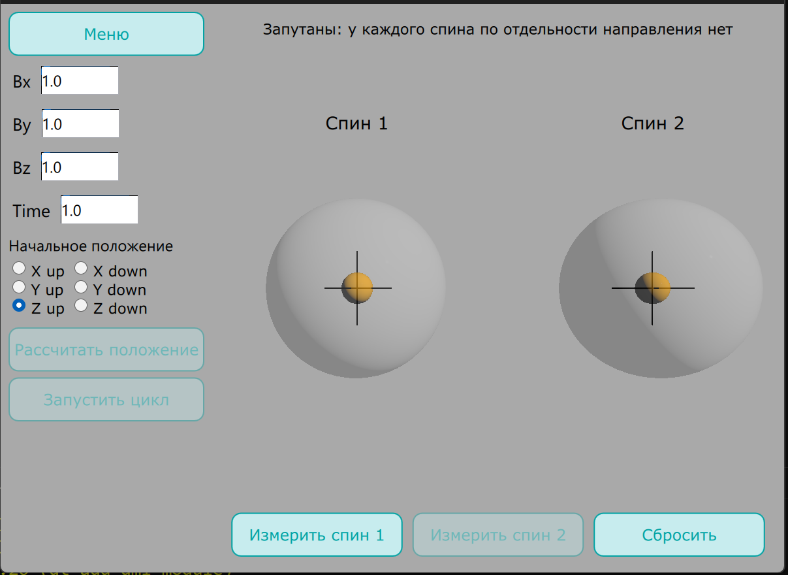

<h1 align="center">Спин в магнитном поле</h1>

<p align="center">
  Численная модель динамики спина 1/2 в постоянном магнитном поле.
  Программа позволяет задавать компоненты поля, начальное состояние
  и время эволюции, а затем наблюдать изменение состояния спина.
</p>
<p align="center">
  
</p>
<p align="center">
  <em>Главная программы: выбор модели с одним или с двумя запутанными спинами.</em>
</p>
<table>
  <tr>
    <td width="50%" align="center">
      
      <br>
      <strong>Модель одного спина</strong>
      <p>Задание компонент магнитного поля Bx, By и Bz, время эволюции и начальное состояние вдоль одной из осей X, Y или Z. После расчёта отображается вектор Блоха.</p>
    </td>
    <td width="50%" align="center">
      
      <br>
      <strong>Модель двух спинов</strong>
      <p>Модель демонстрирует два запутанных спина.</p>
    </td>
  </tr>
</table>

---

## Решение

Рассмотрим частицу со спином $`1/2`$, помещённую в магнитное поле

```math
\vec B=(B_x,B_y,B_z).
```

Гамильтониан частицы со спином $`1/2`$ в магнитном поле записывается через матрицы Паули $`\vec\sigma=(\sigma_x,\sigma_y,\sigma_z)`$:

```math
\hat H=-\frac{\hbar\omega}{2}\,(\vec B\cdot\vec\sigma)
=-\frac{\hbar\omega}{2}\,(B_x\sigma_x+B_y\sigma_y+B_z\sigma_z),
```

где

```math
\sigma_x=
\begin{pmatrix}
0 & 1\\
1 & 0
\end{pmatrix},
\qquad
\sigma_y=
\begin{pmatrix}
0 & -i\\
i & 0
\end{pmatrix},
\qquad
\sigma_z=
\begin{pmatrix}
1 & 0\\
0 & -1
\end{pmatrix}.
```

Умножим каждую матрицу Паули на соответствующую компоненту поля и сложим:

```math
B_x\sigma_x+B_y\sigma_y+B_z\sigma_z=
\begin{pmatrix}
0 & B_x\\
B_x & 0
\end{pmatrix}+
\begin{pmatrix}
0 & -iB_y\\
iB_y & 0
\end{pmatrix}+
\begin{pmatrix}
B_z & 0\\
0 & -B_z
\end{pmatrix}=
\begin{pmatrix}
B_z & B_x-iB_y\\
B_x+iB_y & -B_z
\end{pmatrix}.
```

Обозначим полученную матрицу через $`A`$, а модуль поля через $`B`$:

```math
A=
\begin{pmatrix}
B_z & B_x-iB_y\\
B_x+iB_y & -B_z
\end{pmatrix},
\qquad
B=\sqrt{B_x^2+B_y^2+B_z^2}.
```

Тогда гамильтониан принимает вид

```math
\boxed{\hat H=-\frac{\hbar\omega}{2}A.}
```

### 1. Собственные значения

Решим характеристическое уравнение:

```math
\det(A-\lambda I)=
\begin{vmatrix}
B_z-\lambda & B_x-iB_y\\
B_x+iB_y & -B_z-\lambda
\end{vmatrix}=0.
```

После раскрытия определителя:

```math
\lambda^2-B_x^2-B_y^2-B_z^2=0.
```

Следовательно,

```math
\boxed{\lambda_1=B,\qquad \lambda_2=-B.}
```

Собственные энергии гамильтониана:

```math
\boxed{
E_1=-\frac{\hbar\omega B}{2},
\qquad
E_2=+\frac{\hbar\omega B}{2}.
}
```

### 2. Собственные векторы

Пусть собственный вектор имеет вид

```math
\psi=
\begin{pmatrix}
a\\b
\end{pmatrix}.
```

Из уравнения $`A\psi=\lambda\psi`$, то есть $`(A-\lambda I)\psi=0`$, получаем систему:

```math
\begin{cases}
(B_z-\lambda)a+(B_x-iB_y)b=0,\\
(B_x+iB_y)a-(B_z+\lambda)b=0.
\end{cases}
```

Из второго уравнения выразим $`b`$ через $`a`$:

```math
b=\frac{B_x+iB_y}{B_z+\lambda}\,a.
```

Подставим это $`b`$ в первое уравнение:

```math
(B_z-\lambda)a+(B_x-iB_y)\frac{B_x+iB_y}{B_z+\lambda}\,a=0.
```

Учтём, что $`(B_x-iB_y)(B_x+iB_y)=B_x^2+B_y^2`$, и приведём к общему знаменателю:

```math
\frac{(B_z-\lambda)(B_z+\lambda)+B_x^2+B_y^2}{B_z+\lambda}\,a=0
\quad\Longrightarrow\quad
\frac{B_x^2+B_y^2+B_z^2-\lambda^2}{B_z+\lambda}\,a=0
\quad\Longrightarrow\quad
\frac{B^2-\lambda^2}{B_z+\lambda}\,a=0.
```

Это уравнение выполняется при $`\lambda^2=B^2`$, то есть именно при найденных собственных значениях $`\lambda=\pm B`$. При этом на $`a`$ условий не накладывается: оно остаётся произвольным (общий множитель вектора фиксируется нормировкой). Удобно выбрать $`a=B_z+\lambda`$, тогда знаменатель сокращается и $`b=B_x+iB_y`$.

**Случай $`\lambda_1=B`$.** Выбираем $`a=B_z+B`$, $`b=B_x+iB_y`$:

```math
\psi_1=
\begin{pmatrix}
B+B_z\\
B_x+iB_y
\end{pmatrix}.
```

**Случай $`\lambda_2=-B`$.** Выбираем $`a=B_z-B`$, $`b=B_x+iB_y`$:

```math
\psi_2=
\begin{pmatrix}
B_z-B\\
B_x+iB_y
\end{pmatrix}.
```

**Нормировка.** Учитывая, что $`|B_x+iB_y|^2=B_x^2+B_y^2`$ и $`B_x^2+B_y^2=B^2-B_z^2`$, находим:

```math
N_1^2=(B+B_z)^2+B_x^2+B_y^2
=(B+B_z)^2+B^2-B_z^2
=2B(B+B_z),
```

```math
N_2^2=(B_z-B)^2+B_x^2+B_y^2
=(B-B_z)^2+B^2-B_z^2
=2B(B-B_z).
```

Следовательно,

```math
N_1=\sqrt{2B(B+B_z)},
\qquad
N_2=\sqrt{2B(B-B_z)}.
```

Нормированные собственные векторы:

```math
\boxed{
\psi_1=\frac{1}{N_1}
\begin{pmatrix}
B+B_z\\
B_x+iB_y
\end{pmatrix},
\qquad
\psi_2=\frac{1}{N_2}
\begin{pmatrix}
B_z-B\\
B_x+iB_y
\end{pmatrix}.
}
```

### 3. Начальное состояние

Начальную волновую функцию разложим по собственным векторам:

```math
\psi(0)=\alpha_1\psi_1+\alpha_2\psi_2.
```

Коэффициенты разложения находятся скалярными произведениями:

```math
\boxed{
\alpha_1=\psi_1^\dagger\psi(0),
\qquad
\alpha_2=\psi_2^\dagger\psi(0).
}
```

### 4. Эволюция во времени

По уравнению Шрёдингера каждый собственный вектор приобретает временной фазовый множитель:

```math
\psi(t)=
\alpha_1e^{-iE_1t/\hbar}\psi_1+
\alpha_2e^{-iE_2t/\hbar}\psi_2.
```

Подставляя собственные энергии, получаем:

```math
\boxed{
\psi(t)=
\alpha_1e^{i\omega Bt/2}\psi_1+
\alpha_2e^{-i\omega Bt/2}\psi_2.
}
```

### 5. Проекции спина

Запишем волновую функцию в виде

```math
\psi(t)=
\begin{pmatrix}
\psi_\uparrow(t)\\
\psi_\downarrow(t)
\end{pmatrix}.
```

Средние значения матриц Паули:

```math
\boxed{
\langle\sigma_x\rangle
=2\,\mathrm{Re}
\left(\psi_\uparrow^*\psi_\downarrow\right)
}
```

```math
\boxed{
\langle\sigma_y\rangle
=2\,\mathrm{Im}
\left(\psi_\uparrow^*\psi_\downarrow\right)
}
```

```math
\boxed{
\langle\sigma_z\rangle
=|\psi_\uparrow|^2-|\psi_\downarrow|^2
}
```

Вектор Блоха:

```math
\boxed{
\vec r(t)=
\left(
\langle\sigma_x\rangle,
\langle\sigma_y\rangle,
\langle\sigma_z\rangle
\right).
}
```
